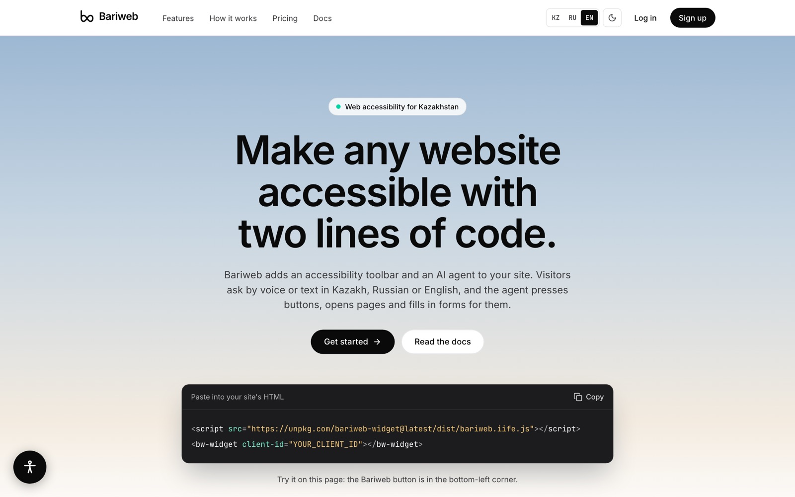
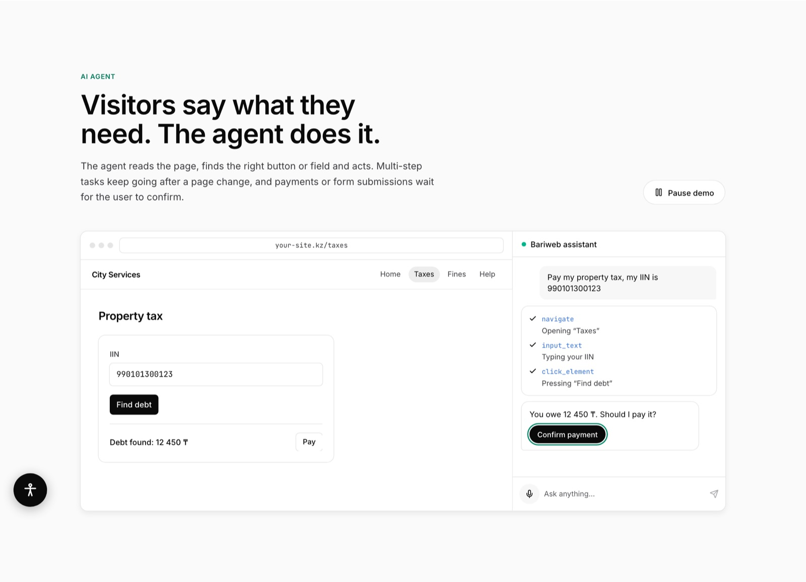
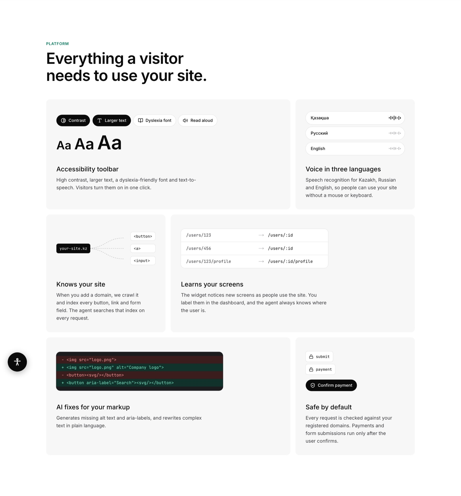

# Bariweb

**Web accessibility for Kazakhstan.** Bariweb makes any website usable for people who find websites hard to use: with two lines of code, a site gets an accessibility toolbar and an AI assistant that does what the visitor asks, by voice or text, in Kazakh, Russian or English.

Website: [bariweb.vercel.app](https://bariweb.vercel.app)

  

## The problem

Paying taxes, booking a doctor, checking a fine or a bank balance: in Kazakhstan, everyday life increasingly runs through websites. But many sites are built only for people who see well, read easily and use a mouse.

- **More than 740,000 people in Kazakhstan live with a disability**, about 3.7% of the population ([gov.kz via QazMonitor, 2025](https://en.qazmonitor.com/news/3132/kazakhstan-enhances-job-opportunities-for-people-with-disabilities)). For someone with low vision, small low-contrast text and unlabeled icon buttons make a site unusable.
- **Almost 9% of the population is 65 or older** ([World Bank data, 2024](https://statisticsoftheworld.com/country/kazakhstan/population-over-65)), and the share keeps growing. Many older people struggle with complex forms and multi-step menus.
- **People with dyslexia or motor impairments** have trouble with dense text and with precise mouse and keyboard work.
- **Language matters.** People should be able to ask for help in the language they think in: Kazakh, Russian or English.

Kazakhstan's Digital Code lists the accessibility and inclusiveness of the digital environment among its basic principles ([oq.gov.kz](https://oq.gov.kz/en/qazalemnews/1383)). In practice, making an existing site accessible usually means an expensive redesign, so most site owners never do it.

## What Bariweb does

Bariweb is added to a website with a script tag and one `<bw-widget>` element. The site's own code stays unchanged.

**An AI assistant that acts for the user.** The visitor says what they need, for example "pay my property tax, my IIN is …". The assistant reads the page, opens the right section, fills in the form and presses the buttons. Payments and form submissions always wait for the user to confirm.

  

**An accessibility toolbar.** High contrast, larger text, a dyslexia-friendly font and read-aloud, each turned on in one click. Voice input works in Kazakh, Russian and English, so the site can be used without a mouse or keyboard.

  

**AI fixes for the site itself.** Bariweb generates missing alt text and aria-labels and rewrites complex text in plain language.

## How it works

1. When a site owner adds their domain, Bariweb crawls the site and indexes every button, link and form field. Each element is enriched with its likely purpose and keywords in Kazakh, Russian and English, then stored in a vector database.
2. When a visitor asks for something, the backend finds the matching elements and an LLM picks the next action: open a page, type text, press a button, or answer.
3. The widget performs the action on the page and keeps going across page changes until the task is done.

On a benchmark of 56 multilingual requests over 504 interface elements from 7 live websites, the enrichment step raised the share of requests where the right element is found first from 52% to 70% (top-3: from 66% to 86%).

**Stack:** FastAPI, PostgreSQL, Milvus, RAGFlow, Playwright, Lit web components, Next.js, Vercel, GitHub Actions.

## Repositories

The source code is private for now.

| Repo | What it is |
| --- | --- |
| `bariweb-app` | Landing page, docs (KZ / RU / EN) and the client dashboard |
| `bariweb-api` | Backend, AI agent and the retrieval pipeline that indexes websites |
| `bariweb-widget` | The embeddable `<bw-widget>` component, published to npm as `bariweb-widget` |

## Team

Bariweb is built by a team of four: [@aidonkee](https://github.com/aidonkee), [@timuchek](https://github.com/timuchek), [@RandomnieBukvi](https://github.com/RandomnieBukvi) and [@Akanov-Kanta](https://github.com/Akanov-Kanta).

[@Akanov-Kanta](https://github.com/Akanov-Kanta) (Nazar Akanov) built most of the retrieval pipeline that lets the assistant find the right element on a page, worked on the backend, the AI agent and the widget, and set up deployment and CI/CD.
